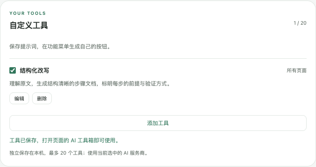
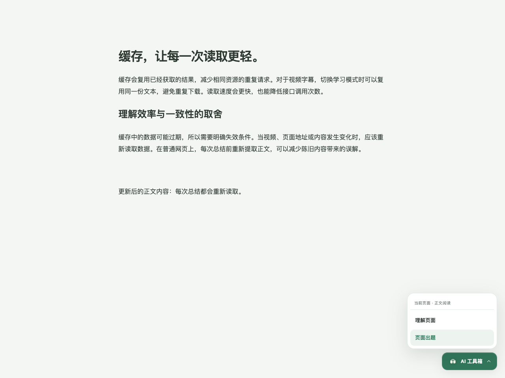
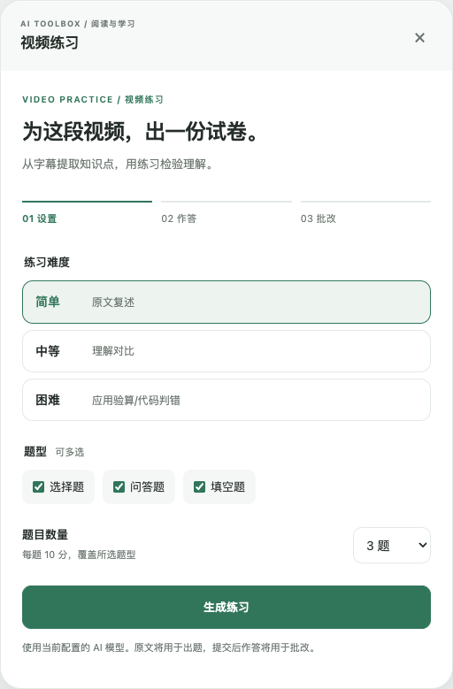

<div align="left">
  
</div>

# AI工具箱

读懂网页与视频，把理解变成自己的知识。

**AI工具箱**（原 DeepSeek 工具箱）是一款基于 Manifest V3 的浏览器扩展。在普通网页、YouTube 和哔哩哔哩视频页，通过一个入口完成内容理解、视频笔记、翻译、分析、练习与自定义提示词生成。

当前版本：**1.7.0**。使用你自己的 API Key，支持 DeepSeek、Kimi、MiMo、OpenAI、Claude 和其他 OpenAI 兼容接口。

[快速开始](#快速开始) · [功能与用法](#功能与用法) · [自定义工具](#自定义工具) · [隐私政策](PRIVACY.md) · [问题反馈](https://github.com/NasNeo777/ChromeTools/issues)

## 功能与用法

页面只显示一个 **「AI 工具箱」** 按钮。点击展开菜单，菜单根据当前页面切换；点击外部或按 Escape 关闭，也可用上下方向键选择功能。

| 场景 | 可用功能 | 内容来源 |
| --- | --- | --- |
| 普通网页 | 理解页面、页面出题、自定义工具 | 已加载且可提取的可见正文 |
| YouTube 视频页 | 视频笔记、翻译原文、批判性分析、评论印证、视频练习、自定义工具 | 视频字幕；评论印证模式额外读取热门评论 |
| 哔哩哔哩视频页 | 与 YouTube 相同的视频学习功能 | 视频字幕（含可获取的 AI 字幕）；评论印证模式额外读取热门评论 |

笔记、翻译、分析和自定义工具生成的结果在侧栏流式显示，可继续追问、复制或下载 HTML。练习提供独立的作答、批改与试卷导出界面。

### 理解网页

打开文章、教程或其他有正文的 HTTP/HTTPS 页面，点击 **AI 工具箱 → 理解页面**，生成内容概述、核心要点与脉络，再结合原文继续追问。

每次操作会重新提取正文。提取过程会过滤表单、可编辑区域、隐藏内容和导航等元素，优先选择文章或主体区域；正文超过 48,000 个字符时只提供前段，并标注截断。页面结构复杂时仍可能混入非正文文本，请结合来源核对。

### 学习视频

- **视频笔记**：将字幕整理为结构化文档、精炼摘要或要点清单。
- **翻译原文**：按字幕行翻译并保留时间戳。较长字幕可能受到输入截断或模型输出长度限制，不能保证覆盖整段视频。
- **批判性分析**：评估论据、逻辑、可信度与表达方式，帮助识别夸大、偏见和遗漏。
- **评论印证**：结合热门评论判断其是否提供独立佐证，同时关注质疑、重复附和和样本偏差。
- **追问**：围绕已有结果继续提问，模型会结合字幕、已生成内容和部分对话历史回答。

YouTube 视频页入口通常位于标题附近；哔哩哔哩及普通网页入口通常浮动在右下角。哔哩哔哩字幕接口通常需要登录；分 P 视频按当前分集读取。两平台都需要有可获取的字幕，插件不进行语音转写或视频画面识别。

### 出题与批改

点击 **页面出题** 或 **视频练习**，选择难度、题型与题数，再生成试卷。

| 难度 | 固定定义 |
| --- | --- |
| 简单 | 原文复述 |
| 中等 | 理解对比 |
| 困难 | 应用验算 / 代码判错；非技术内容使用有明确条件的应用推理 |

支持单项选择、问答、填空，可混合选择；界面提供 3、4、5、6、8、10、12 题，每题 10 分。

选择题在本地按参考答案判分，未作答题目记 0 分；填空和问答由 AI 根据参考答案及评分要点评估。提交后显示总分、逐题反馈、参考答案、评分要点和原文依据，可修改答案再练。批改失败时当前作答会保留，方便重试。

**导出试卷**生成不含参考答案的 HTML；**导出答案**单独生成解答、解析和评分要点。用浏览器打开导出的文件，可打印或通过打印对话框另存为 PDF。当前不直接导出 DOCX、Markdown 或原生 PDF，也不将个人作答和批改记录作为独立文件导出。

AI 生成的题目、答案与分数可能有误，原文依据也需要核对。代码判错采用模型分析，不实际执行代码。

## 快速开始

1. 下载或克隆本仓库，在 Chrome 打开 `chrome://extensions/`。
2. 开启「开发者模式」，点击「加载已解压的扩展程序」，选择包含 `manifest.json` 的项目目录。
3. 点击浏览器工具栏里的扩展图标，选择 AI 服务商，填写 API Key 和账号可用的模型 ID，点击「保存设置」。需要时展开「API 地址」修改 Base URL。
4. 刷新已打开的网页或视频页，点击页面上的「AI 工具箱」选择功能。

本项目使用原生 JavaScript，无需安装运行依赖或执行前端构建。扩展本身不要求注册独立账号；API 的账号、调用额度、网络可达性与费用由所选服务商决定。

升级时，在扩展管理页重新加载扩展，再刷新目标页面。旧版 DeepSeek Key、总结风格和输出语言继续兼容；旧模型 ID 会映射到新模型，并保留原 ID 信息。

## 配置 AI 服务

各服务商分别保存 Key、模型 ID 和 Base URL，切换后点击「保存设置」生效。自定义工具使用当前选中的服务商。

| 服务商 | 内置 API Base URL | 接口协议 |
| --- | --- | --- |
| DeepSeek | `https://api.deepseek.com` | Chat Completions |
| Kimi | `https://api.moonshot.cn/v1` | Chat Completions |
| MiMo | `https://api.xiaomimimo.com/v1` | Chat Completions |
| OpenAI | `https://api.openai.com/v1` | Chat Completions |
| Claude | `https://api.anthropic.com/v1` | Messages |
| 其他兼容服务 | 用户填写 HTTPS Base URL | OpenAI Chat Completions 兼容协议 |

DeepSeek 默认使用 **`deepseek-flash`**（关闭思考模式），另提供 **`deepseek-v4-pro`**（启用思考模式）。旧 `deepseek-chat` 映射为 `deepseek-flash`，旧 `deepseek-reasoner` 映射为 `deepseek-v4-pro`。

其他服务的建议模型可在设置里查看，也可以手动填写模型 ID。建议值不代表账号必然有访问权限或服务商会持续提供该模型，请以服务商控制台为准。所有 AI 请求只使用当前选定配置的 Key；修改任一服务商的 Base URL 后，该 Key 和请求资料会发送至修改后的地址。

## 自定义工具

把常用提示词变成页面菜单里的按钮：

1. 打开扩展设置，在「自定义工具」点击「添加工具」。
2. 填写按钮名称和提示词，选择「所有页面」「普通网页」或「视频页」。
3. 点击「保存工具」，已打开页面的菜单会自动更新。
4. 在 **AI 工具箱 → 我的工具** 中点击新增按钮，结合当前正文或字幕生成内容。

例如，按钮名称填写「行动清单」，提示词填写：

```text
理解当前内容，提炼三项可执行的行动。
每项说明具体动作、前提条件和验证方式。
区分原文已有的建议与补充建议，缺失的信息不要编造。
```

无需在提示词中手动粘贴原文。支持编辑、启用/停用和删除，最多保存 20 个工具；名称最长 24 个字符，提示词最长 12,000 个字符。工具独立保存，不要求同时保存 API 配置，但运行时需要有效的 API 设置。

生成结果可继续追问、复制和下载。已有对话保留当次使用的任务上下文，之后编辑、停用或删除工具不会立即抹除该对话。自定义工具属于文本配置，不加载用户脚本或执行生成的代码。



## 界面预览





这些预览来自模拟页面与 AI 返回的浏览器验证，用于展示界面和流程，不代表真实 API 调用质量。

## 隐私与权限

点击功能前，请确认当前内容适合发送给所选服务商。插件通过浏览器后台直接请求配置的 API，不经过开发者运营的内容中转服务。

| 数据 | 存放位置与用途 |
| --- | --- |
| 各家 API Key、模型、接口地址、总结风格、语言及所选服务商 | `chrome.storage.sync`；启用 Chrome 同步时，可能同步到账号的其他设备 |
| 自定义工具的名称、提示词、范围和状态 | `chrome.storage.local`；不自动跨设备同步 |
| 抓取的正文、字幕、评论、对话、试卷和作答 | 当前页面生命周期内的内存；不自动持久化保存，刷新或关闭页面会丢失 |
| 主动复制或导出的内容 | 系统剪贴板或浏览器下载位置，由用户管理 |

API Key 会作为认证信息发送给所配置的目标接口；正文、字幕、部分来源信息、提示词、追问和需要批改的主观题作答会按功能需要发送给当前服务商。本扩展不内置广告、分析统计或浏览历史采集功能。完整的数据处理、保留和删除说明见 [Privacy Policy](PRIVACY.md)；可部署的独立网页为 [privacy.html](privacy.html)。

当前清单声明 `storage`、`activeTab` 及 HTTP/HTTPS 主机访问权限：`storage` 用于配置和自定义工具；当前活动页信息用于在设置面板提示工具可用性；主机访问用于网页入口、按需正文提取、视频平台接口和配置的 AI 接口。浏览器设置页、扩展商店等受限页面无法注入。

## 常见问题

**没有出现入口。** 重新加载扩展后刷新页面，检查扩展是否获准访问当前网站；浏览器受限页面不支持。

**网页读取为空或内容不完整。** 等待正文加载后重试，优先打开文章详情页。跨域 iframe、图片、视频画面、未加载内容和独立 PDF 文档不在当前正文提取范围内。

**视频提示没有字幕。** 确认视频有可获取的字幕轨道；在哔哩哔哩先登录。不能仅凭视频存在就保证能取得字幕，平台接口变化和访问限制也可能导致失败。

**API 调用失败或模型不可用。** 检查 Key、模型 ID、Base URL、余额和网络。部分服务商的国内、国际或订阅接口使用不同配置，需填写对应地址；兼容接口也可能存在参数差异。

**刷新后练习或对话不见了。** 当前版本没有持久化学习记录功能。重要内容请及时复制或导出；站内切换页面时，上一份结果也可能暂留在内存中，请核对来源标题。

**自定义工具没有显示。** 检查工具是否已保存、启用且适用当前页面；新安装或更新扩展后先刷新页面。工具保存在本机，更换设备不会自动带过来。

## 开发与验证

| 文件 | 职责 |
| --- | --- |
| `manifest.json` | 扩展名称、版本、权限与脚本注册 |
| `popup.html` / `popup.css` / `popup.js` | 服务商配置与通用设置界面 |
| `providers.js` | 独立服务商配置、旧模型兼容、请求与流式事件适配 |
| `tools.js` | 内置工具设置说明 |
| `background.js` | AI 调用、出题、批改与追问的后台消息处理 |
| `content-core.js` / `content.css` | 单按钮菜单、平台选择、侧栏、结果展示与导出 |
| `content-page.js` | 普通网页的可见正文提取 |
| `content-youtube.js` / `content-bilibili.js` | 视频字幕与热门评论适配 |
| `quiz-shared.js` / `quiz-content.js` | 试卷校验、练习界面、评分与试卷/答案导出 |
| `custom-tools.js` / `custom-tools-editor.js` | 自定义工具校验、适用范围与本地编辑保存 |
| `icons/` | 新 logo、扩展图标及旧图标备份 |
| `tests/` | 逻辑、协议和浏览器流程验证 |

使用 Node.js 内置测试运行器：

```sh
node --test tests/*.test.cjs
```

浏览器流程验证需要环境中已有 Playwright 和 Google Chrome，不属于扩展的运行依赖：

```sh
node tests/practice-ui.cjs
node tests/page-ui.cjs
node tests/custom-tools-ui.cjs
```

若 Playwright 不在模块搜索路径内，可通过 `PLAYWRIGHT_MODULE` 指向其安装目录。测试使用模拟的 Chrome 存储、平台数据或 AI 返回，不替代各服务商的真实 Key 联调。

历史案例和重写前的文档保存在 [README 归档](docs/legacy/README-before-1.7-rewrite.md)，旧版隐私政策保存在 [1.5 归档](docs/legacy/PRIVACY-1.5.md)。历史说明不能替代当前版本文档。

## 反馈与联系

功能问题请提交 [GitHub Issue](https://github.com/NasNeo777/ChromeTools/issues)。隐私或账号相关问题请联系 [bigbugbbb@gmail.com](mailto:bigbugbbb@gmail.com)，不要公开提交完整 API Key、私人页面正文或包含敏感信息的截图。
