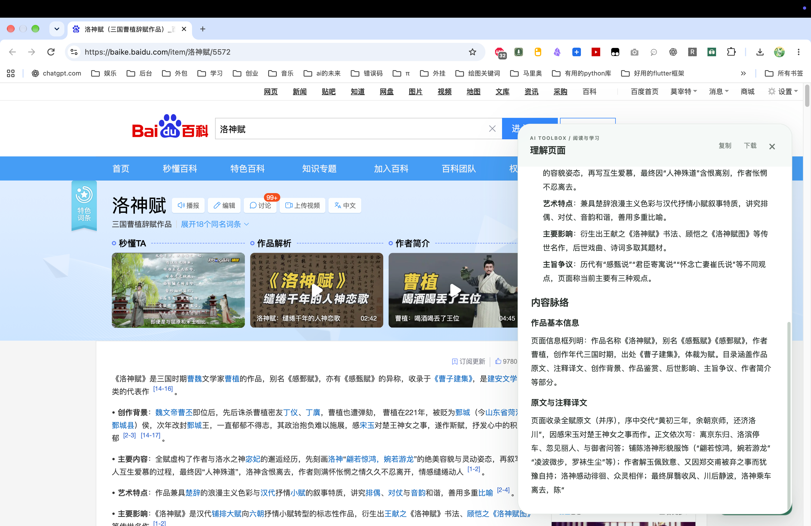
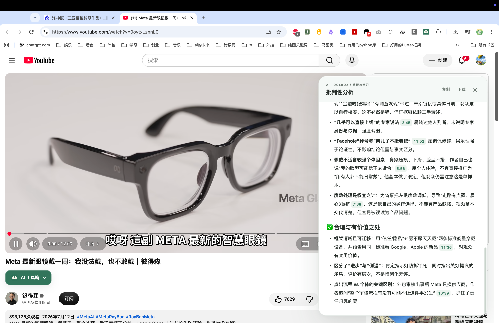
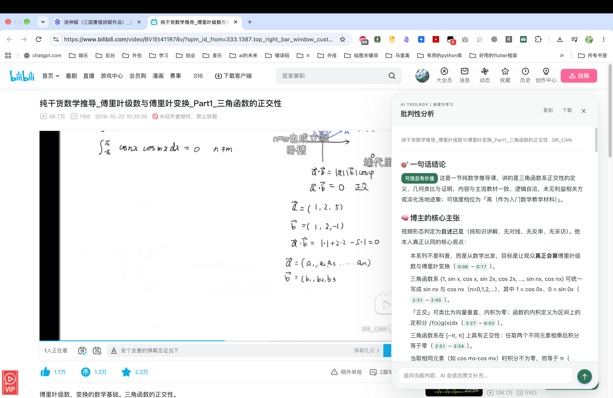
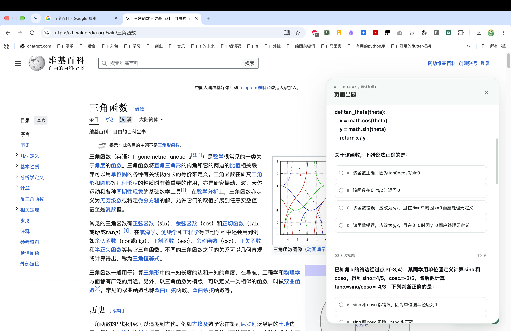
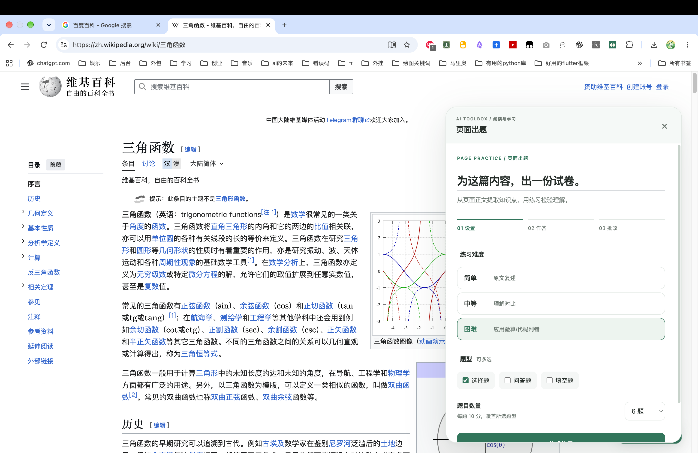
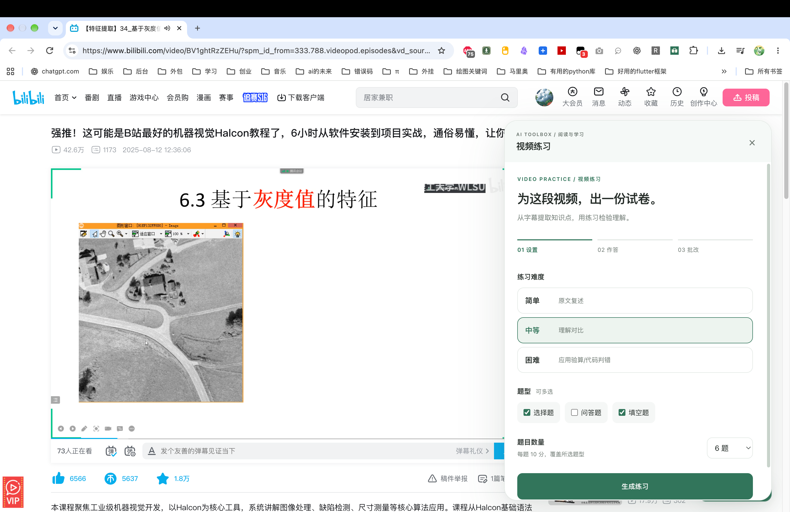
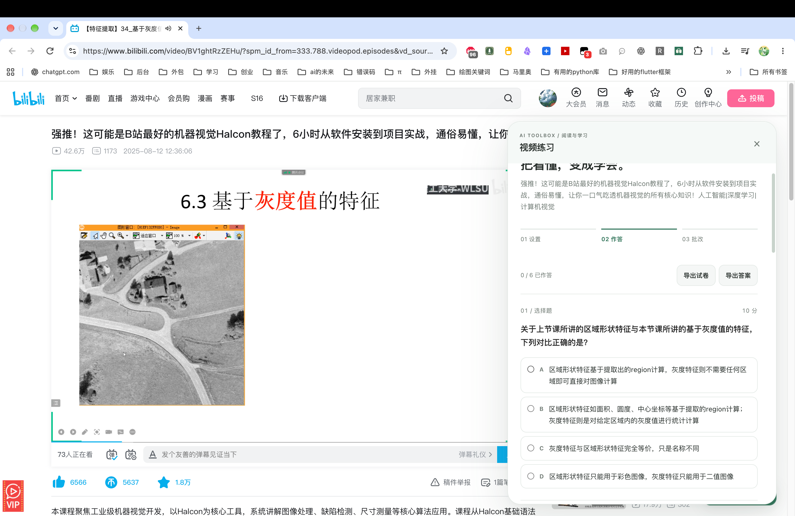
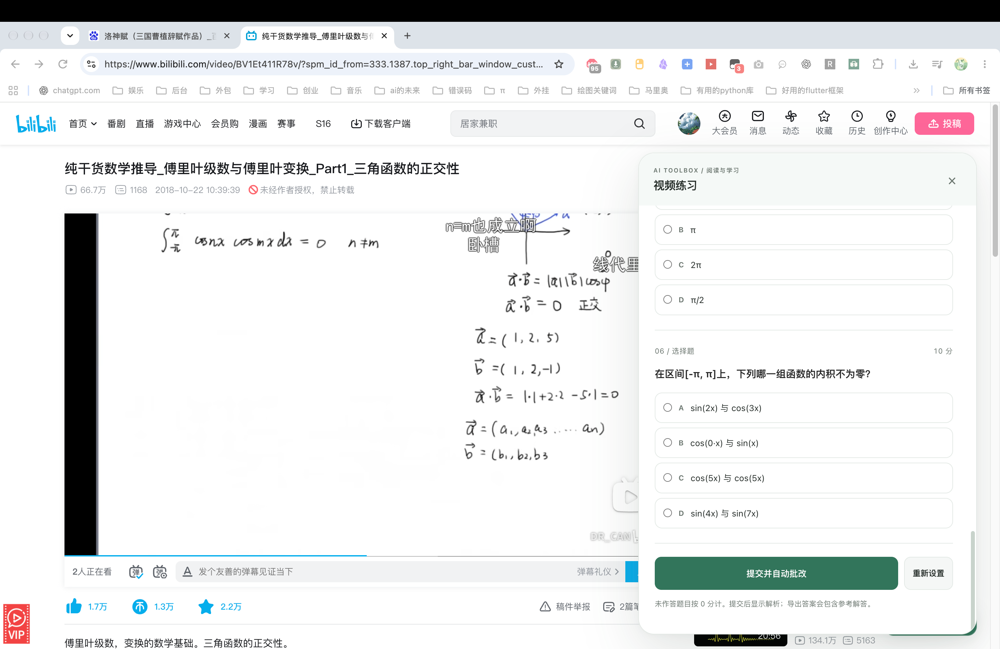

# AI工具箱

### 读懂网页与视频，把理解变成自己的知识。

在网页、YouTube 和哔哩哔哩中，总结内容、翻译字幕、分析观点，再用一份自测检查理解。所有功能，从页面上的一个按钮开始。

**v1.7.0** · Chrome 扩展 · 自备 API Key · 支持多家 AI 服务

[安装使用](#快速开始) / [功能演示](#功能演示) / [配置模型](#配置-ai-服务) / [自定义工具](#自定义工具) / [常见问题](#常见问题)



*在原文旁边阅读总结，随时对照、追问。*

## 快速开始

1. **加载扩展** — 下载或克隆本仓库，打开 `chrome://extensions/`，开启「开发者模式」，点击「加载已解压的扩展程序」，选择包含 `manifest.json` 的项目目录。
2. **配置模型** — 点击浏览器工具栏中的扩展图标，选择服务商，填写 API Key 和账号可用的模型 ID，再点击「保存设置」。需要时展开「API 地址」修改 Base URL。
3. **开始使用** — 刷新网页或视频页，点击页面上的 **AI 工具箱**，选择要用的功能。

无需安装运行依赖或执行前端构建，也无需注册独立的插件账号。API 账号、额度、网络与费用由所选服务商决定。

> 视频功能依赖可获取的字幕；使用哔哩哔哩时通常需要先登录。重要结果请及时复制或导出，刷新页面会清除当前对话和作答。

## 功能演示

| 你想做什么 | 选择功能 | 使用场景 |
| --- | --- | --- |
| 快速掌握内容 | 总结网页 / 总结视频 | 文章、教程、知识词条与视频 |
| 阅读外语字幕 | 翻译字幕 | YouTube、哔哩哔哩 |
| 判断论据是否充分 | 分析观点 / 结合评论分析 | YouTube、哔哩哔哩 |
| 检查学会了多少 | 出题自测 | 普通网页与视频 |
| 运行自己的提示词 | 我的工具 | 按自定义范围显示 |

菜单随页面类型切换。YouTube 入口通常在标题附近，普通网页和哔哩哔哩入口通常浮动在右下角；点击外部或按 Escape 关闭菜单，也可用上下方向键选择功能。

以下均为用户在实际网站截取的画面，保留拍摄时的文案。「页面出题」「视频练习」现已统一为「出题自测」，功能名称以本文为准。

### 01 / 阅读与总结

打开文章或教程，选择 **总结网页**，在侧栏查看概述、要点与内容脉络。视频页选择 **总结视频**，可整理为结构化文档、精炼摘要或要点清单。生成结果可继续追问、复制或下载 HTML。

网页总结效果见上方《洛神赋》截图。每次操作重新提取已加载的可见正文，过滤表单、编辑区域、隐藏内容和导航；超过 48,000 字符时只提供前段并标注截断。复杂页面仍可能混入非正文，请结合来源核对。

**翻译字幕**按字幕行翻译并保留时间戳。较长字幕可能受输入截断或输出长度限制，不能保证覆盖完整视频。插件不进行语音转写或视频画面识别；哔哩哔哩分 P 视频按当前分集读取。

### 02 / 分析观点

结合视频字幕，检查论据、逻辑和表达方式，关注夸大、偏见与遗漏。选择 **结合评论分析** 时，还会读取热门评论，区分独立佐证、质疑和重复附和。



*YouTube · Meta 智能眼镜：对照字幕查看观点分析。*

<details>
<summary>查看哔哩哔哩课程的分析示例</summary>



*哔哩哔哩 · 傅里叶级数：梳理三角函数正交性的推导与论证。*

</details>

### 03 / 出题自测

读完文章或看完课程，选择 **出题自测**，设置难度、题型和题数。生成后直接作答，提交即可查看分数、解析、参考答案和原文依据。



*维基百科 · 三角函数：根据正文生成题目，检查概念与计算是否掌握。*

| 难度 | 题目侧重 |
| --- | --- |
| 简单 | 原文复述 |
| 中等 | 理解与对比 |
| 困难 | 应用验算、代码判错；非技术内容使用有明确条件的应用推理 |

支持选择、问答、填空，可混合选择；提供 3、4、5、6、8、10、12 题，每题 10 分。选择题在本地判分，填空和问答由 AI 根据参考答案及评分要点评估，未作答记 0 分。批改失败会保留当前作答，支持重试或修改答案再练。

**导出试卷**与**导出答案**分别生成 HTML 文件。用浏览器打开后，可打印或通过打印对话框另存为 PDF；当前不直接导出 DOCX、Markdown、原生 PDF，也不单独导出个人作答和批改记录。

<details>
<summary>查看自测设置与更多视频出题示例（4 张）</summary>

**维基百科 · 三角函数 / 设置难度、题型与题数**



**哔哩哔哩 · Halcon 教程 / 设置视频自测**



**哔哩哔哩 · Halcon 教程 / 作答与导出**



**哔哩哔哩 · 傅里叶级数 / 检验三角函数正交性**



</details>

AI 生成的题目、答案与分数可能有误，请结合原文复核。代码判错采用模型分析，不实际执行代码；评论分析也不能替代独立事实核查。

## 配置 AI 服务

各服务商分别保存 Key、模型 ID 和 Base URL，切换后点击「保存设置」生效。自定义工具使用当前选中的服务商。

| 服务商 | 内置 API Base URL | 接口协议 |
| --- | --- | --- |
| DeepSeek | `https://api.deepseek.com` | Chat Completions |
| Kimi | `https://api.moonshot.cn/v1` | Chat Completions |
| MiMo | `https://api.xiaomimimo.com/v1` | Chat Completions |
| OpenAI | `https://api.openai.com/v1` | Chat Completions |
| Claude | `https://api.anthropic.com/v1` | Messages |
| 其他兼容服务 | 用户填写 HTTPS Base URL | OpenAI Chat Completions 兼容协议 |

DeepSeek 默认使用 **`deepseek-flash`**（关闭思考模式），另提供 **`deepseek-v4-pro`**（启用思考模式）。旧 `deepseek-chat` 映射为 `deepseek-flash`，旧 `deepseek-reasoner` 映射为 `deepseek-v4-pro`。

其他服务的建议模型可在设置里查看，也可以手动填写模型 ID。建议值不代表账号必然有访问权限或服务商会持续提供该模型，请以服务商控制台为准。所有 AI 请求只使用当前选定配置的 Key；修改任一服务商的 Base URL 后，该 Key 和请求资料会发送至修改后的地址。

<details>
<summary>升级与旧版配置兼容</summary>

升级时，在扩展管理页重新加载扩展，再刷新目标页面。旧版 DeepSeek Key、总结风格和输出语言继续兼容；旧模型 ID 会映射到新模型，并保留原 ID 信息。本项目原名为 DeepSeek 工具箱。

</details>

## 自定义工具

把常用提示词变成页面菜单里的按钮：

1. 打开扩展设置，在「自定义工具」点击「添加工具」。
2. 填写按钮名称和提示词，选择「所有页面」「普通网页」或「视频页」。
3. 点击「保存工具」，已打开页面的菜单会自动更新。
4. 在 **AI 工具箱 → 我的工具** 中点击新增按钮，结合当前正文或字幕生成内容。

例如，按钮名称填写「行动清单」，提示词填写：

```text
理解当前内容，提炼三项可执行的行动。
每项说明具体动作、前提条件和验证方式。
区分原文已有的建议与补充建议，缺失的信息不要编造。
```

无需在提示词中手动粘贴原文。支持编辑、启用/停用和删除，最多保存 20 个工具；名称最长 24 个字符，提示词最长 12,000 个字符。工具独立保存，不要求同时保存 API 配置，但运行时需要有效的 API 设置。

生成结果可继续追问、复制和下载。已有对话保留当次使用的任务上下文，之后编辑、停用或删除工具不会立即抹除该对话。自定义工具属于文本配置，不加载用户脚本或执行生成的代码。

## 常见问题

<details>
<summary>页面上没有出现 AI 工具箱</summary>

重新加载扩展后刷新页面，检查扩展是否获准访问当前网站。浏览器设置页、扩展商店等受限页面无法注入。

</details>

<details>
<summary>正文不完整，或者视频没有字幕</summary>

网页需等待正文加载后再操作，优先打开文章详情页。跨域 iframe、图片、视频画面、未加载内容和独立 PDF 不在提取范围内。

视频需要有可获取的字幕轨道，哔哩哔哩通常需要登录。平台接口变化和访问限制也可能导致字幕获取失败。

</details>

<details>
<summary>API 调用失败或模型不可用</summary>

检查 Key、模型 ID、Base URL、余额和网络。部分服务商的国内、国际或订阅接口使用不同配置，需填写对应地址；兼容接口也可能存在参数差异。

</details>

<details>
<summary>刷新后对话或作答不见了</summary>

当前没有持久化学习记录功能，重要结果请及时复制或导出。站内切换页面时，上一份结果也可能暂留在内存中，请核对来源标题。

</details>

<details>
<summary>自定义工具没有显示</summary>

检查工具是否已保存、启用且适用当前页面。新安装或更新扩展后先刷新页面；工具保存在本机，不会自动同步到其他设备。

</details>

## 隐私与权限

点击功能前，请确认当前内容适合发送给所选服务商。插件通过浏览器后台直接请求配置的 API，不经过开发者运营的内容中转服务。

| 数据 | 存放位置与用途 |
| --- | --- |
| 各家 API Key、模型、接口地址、总结风格、语言及所选服务商 | `chrome.storage.sync`；启用 Chrome 同步时，可能同步到账号的其他设备 |
| 自定义工具的名称、提示词、范围和状态 | `chrome.storage.local`；不自动跨设备同步 |
| 抓取的正文、字幕、评论、对话、试卷和作答 | 当前页面生命周期内的内存；不自动持久化保存，刷新或关闭页面会丢失 |
| 主动复制或导出的内容 | 系统剪贴板或浏览器下载位置，由用户管理 |

API Key 会作为认证信息发送给所配置的目标接口；正文、字幕、部分来源信息、提示词、追问和需要批改的主观题作答会按功能需要发送给当前服务商。本扩展不内置广告、分析统计或浏览历史采集功能。完整的数据处理、保留和删除说明见 [Privacy Policy](PRIVACY.md)；可部署的独立网页为 [privacy.html](privacy.html)。

当前清单声明 `storage`、`activeTab` 及 HTTP/HTTPS 主机访问权限：`storage` 用于配置和自定义工具；当前活动页信息用于在设置面板提示工具可用性；主机访问用于网页入口、按需正文提取、视频平台接口和配置的 AI 接口。浏览器设置页、扩展商店等受限页面无法注入。

## 开发与验证

<details>
<summary>项目结构、验证命令与历史文档</summary>

| 文件 | 职责 |
| --- | --- |
| `manifest.json` | 扩展名称、版本、权限与脚本注册 |
| `popup.html` / `popup.css` / `popup.js` | 服务商配置与通用设置界面 |
| `providers.js` | 独立服务商配置、旧模型兼容、请求与流式事件适配 |
| `tools.js` | 内置工具设置说明 |
| `background.js` | AI 调用、出题、批改与追问的后台消息处理 |
| `content-core.js` / `content.css` | 单按钮菜单、平台选择、侧栏、结果展示与导出 |
| `content-page.js` | 普通网页的可见正文提取 |
| `content-youtube.js` / `content-bilibili.js` | 视频字幕与热门评论适配 |
| `quiz-shared.js` / `quiz-content.js` | 试卷校验、练习界面、评分与试卷/答案导出 |
| `custom-tools.js` / `custom-tools-editor.js` | 自定义工具校验、适用范围与本地编辑保存 |
| `icons/` | 新 logo、扩展图标及旧图标备份 |
| `tests/` | 逻辑、协议和浏览器流程验证 |

使用 Node.js 内置测试运行器：

```sh
node --test tests/*.test.cjs
```

浏览器流程验证需要环境中已有 Playwright 和 Google Chrome，不属于扩展的运行依赖：

```sh
node tests/practice-ui.cjs
node tests/page-ui.cjs
node tests/custom-tools-ui.cjs
```

若 Playwright 不在模块搜索路径内，可通过 `PLAYWRIGHT_MODULE` 指向其安装目录。测试使用模拟的 Chrome 存储、平台数据或 AI 返回，不替代各服务商的真实 Key 联调。

历史案例和重写前的文档保存在 [README 归档](docs/legacy/README-before-1.7-rewrite.md)，旧版隐私政策保存在 [1.5 归档](docs/legacy/PRIVACY-1.5.md)。历史说明不能替代当前版本文档。

</details>

## 反馈与联系

功能问题请提交 [GitHub Issue](https://github.com/NasNeo777/ChromeTools/issues)。隐私或账号相关问题请联系 [bigbugbbb@gmail.com](mailto:bigbugbbb@gmail.com)，不要公开提交完整 API Key、私人页面正文或包含敏感信息的截图。
